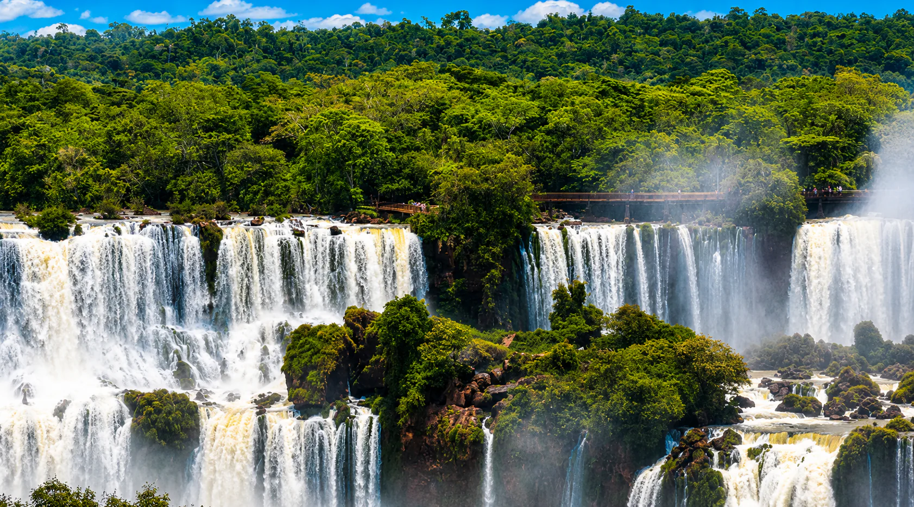
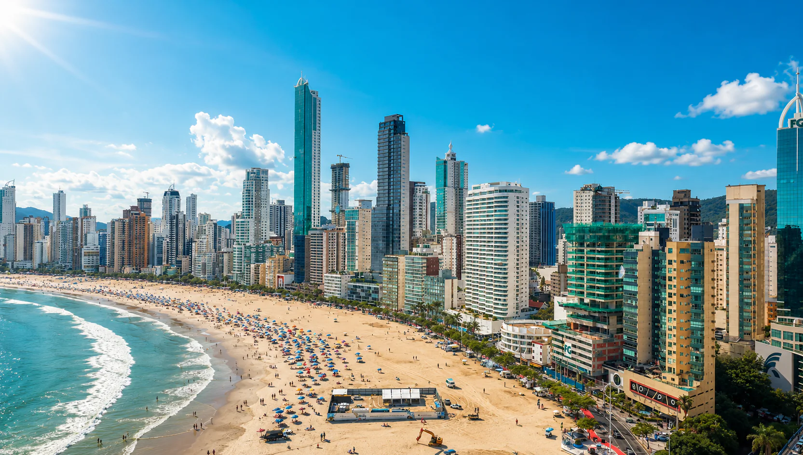

# Travel blog

Static pages for the Pablo & Luisa travel blog. There is no build step. GitHub Pages serves each folder’s `index.html` as a clean URL.

The blog is separate from the Santa Catarina sales page in `guides/santa-catarina/`. Do not move, edit, or merge that guide into the blog.

Visual design lives in one file, [`blog.css`](blog.css). Those rules match the home page (`index.html`): the same CSS variables, system / SF Pro stack, dark translucent navbar, section labels, buttons, destination cards, tour cards, and footer. Add a place by copying a folder and reusing those classes. Do not invent a second stylesheet.

## Map

```
blog/
  index.html                         /blog/
  south-america/
    index.html                       /blog/south-america/
    brazil/
      index.html                     /blog/south-america/brazil/
      balneario-camboriu/index.html  …/brazil/balneario-camboriu/
      rio-de-janeiro/index.html
    argentina/
      index.html
      puerto-iguazu/index.html       Puerto Iguazú / Iguazú Falls
    colombia/
      index.html                     Country page only; cities coming soon
```

Hierarchy is continent, then country, then city. City pages hold the photos, tour links, and (later) posts.

## Add a city

1. Copy an existing city folder. `rio-de-janeiro/` is the short template. `balneario-camboriu/` shows several tours.
2. Rename the folder with a lowercase slug: `buenos-aires`. The URL is the folder path.
3. In the new `index.html`, replace the title, meta description, canonical URL, Open Graph URL, breadcrumb labels and links, hero text, and placeholder name.
4. On the parent country page, add one card inside `.destination-grid`:

```html
<a class="destination-card" href="/blog/south-america/argentina/buenos-aires/">
  
  <span class="dest-tag">Argentina</span>
  <div class="destination-card-overlay">
    <h3>Buenos Aires</h3>
    <span>1 tour</span>
  </div>
</a>
```

5. If this is the first or second city, add `cols-1` or `cols-2` on the grid. Three or more cities use the plain `destination-grid` (three columns, same as the home page).

## Add a country

1. Copy `blog/south-america/colombia/` (empty city list) or `blog/south-america/argentina/` (one city).
2. Put it in the right continent folder: `blog/south-america/peru/index.html`.
3. Update the title, description, canonical URL, breadcrumbs, heading, and placeholder.
4. Add a card on the continent page (`blog/south-america/index.html`) that links to the new country.
5. Leave the city area as the “Cities coming soon” card until a city folder exists. That card uses `destination-card destination-card-plain destination-card-static` and is not a link.

## Add a continent

1. Copy `blog/south-america/` to `blog/europe/` (or start from `colombia/` if the continent should not list countries yet).
2. Update breadcrumbs so the trail is Blog → Europe.
3. Add one card on `blog/index.html` only when the continent has a real page. Do not add empty continents.

## Photos, posts, and tours

City pages already use the home page tour card (photo, description, booking buttons). Copy a `.tour-card` block to add another tour. Keep the link text and button classes: `btn btn-gyg`, `btn btn-viator`, `btn btn-tripadvisor`. A tour that is not on sale yet uses `btn btn-coming-soon`.

The Journal block at the bottom is where posts go. Replace the “No stories published yet” card with a `.channel-card` per story. Do not publish the placeholder.

Extra photos that are not attached to a tour can be another `.destination-card` (or a `.tour-card` with no buttons) in a `.destination-grid`.

## Copy you still have to write

Every page has a white card whose label reads **Placeholder — replace this text**. That card is for the owner’s own introduction. Replace it, including the label. Do not invent a personal travel story to fill the gap. Tour descriptions already published on the home page can be reused as-is.

## Images

Photos are the resized WebP files in `/images/`, the same ones the home page uses. The original root PNGs are gone. Point `src` at the largest variant and list every width in `srcset`, with a root-absolute path so the tag works in any folder.

Cards and tour photos use the home page size hint. Full-bleed heroes use `sizes="100vw"`.

```html

```

`width` and `height` stay the original pixel size (the same numbers as on the home page) so the ratio is right even when the file served is smaller. Rio de Janeiro still uses the Unsplash photo already on the home page, because there is no local file for it.

| Place | Files |
| --- | --- |
| Balneário Camboriú | `images/balneario-640.webp`, `balneario-1200.webp`, `balneario-1665.webp` |
| Iguazú | `images/iguazu-640.webp`, `iguazu-1200.webp`, `iguazu-1683.webp` |
| Pirate boat | `images/pirate-boat-640.webp`, `pirate-boat-1100.webp`, `pirate-boat-1600.webp` |
| Food tour | `images/food-tour-640.webp`, `food-tour-1100.webp`, `food-tour-1600.webp` |
| Cable car | `images/cable-car-640.webp`, `cable-car-1100.webp`, `cable-car-1600.webp` |
| Northern beaches | `images/northern-beaches-640.webp`, `northern-beaches-1100.webp`, `northern-beaches-1506.webp` |
| Aquarium | `images/aquarium-640.webp`, `aquarium-1100.webp`, `aquarium-1496.webp` |

## Navbar and footer

Copy the `<nav class="navbar">` and `<footer>` from a blog page when you create a new one. Section links point at the home page (`/#travel`, `/#music`, and the rest). The Blog link stays `aria-current="page"`. The small menu script at the bottom of the page is part of the copy; it only appears under 840px so the same six links still fit.

Favicons in `<head>` are the same files as the home page (`/favicon-32x32.png`, `/apple-touch-icon.png`, and the rest). Give every page its own `<title>`, meta description, canonical URL, and Open Graph tags.
